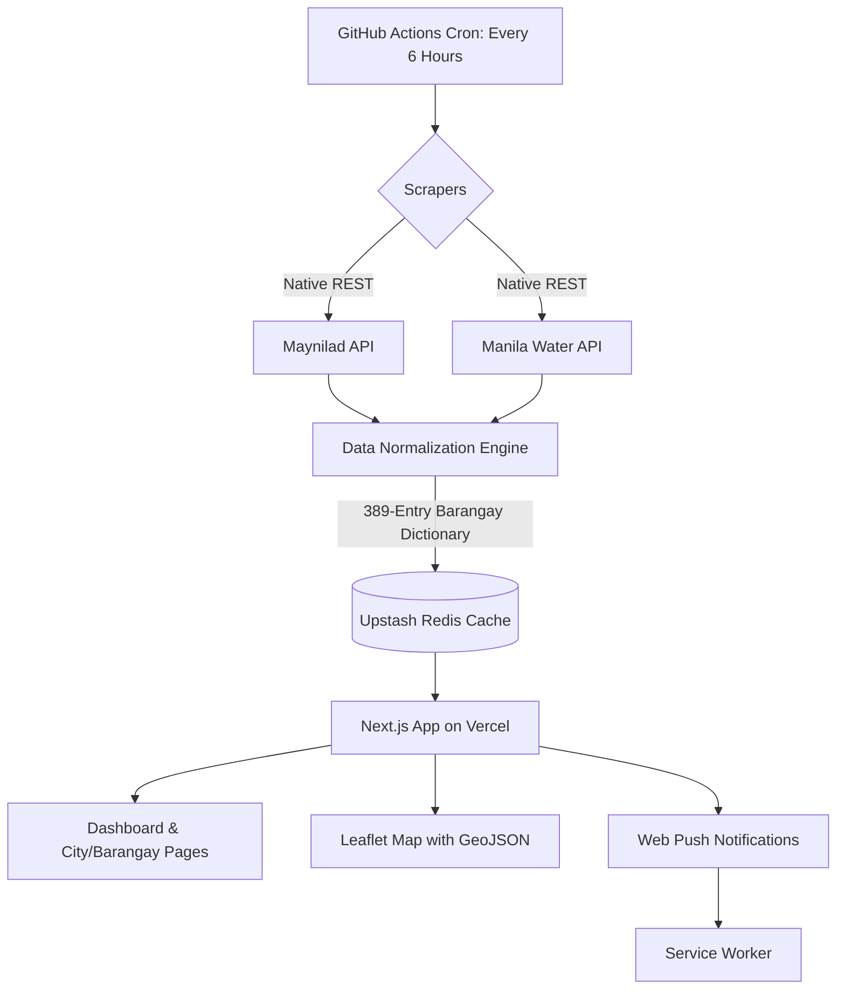

# TubigWatch 💧

**Live App:** [https://tubigwatch.vercel.app](https://tubigwatch.vercel.app) · **Interactive Map:** [https://tubigwatch.vercel.app/map](https://tubigwatch.vercel.app/map)

TubigWatch is a high-availability, real-time water outage tracker for Metro Manila. It aggregates live advisories from both Maynilad and Manila Water into a single, unified dashboard, complete with Web Push notifications, offline PWA capabilities, and a GIS-style map with barangay-level polygons.

## 🚀 The Problem
During typhoon season, water advisories are scattered across slow, mobile-hostile websites. Furthermore, serverless platforms like Vercel have strict timeout limits (60 seconds), making it impossible to scrape 18+ pages of data on-demand. 

## 🏗️ System Architecture

To bypass serverless timeouts, TubigWatch decouples the ingestion engine from the web app. A scheduled GitHub Action scrapes the data, normalizes it, and caches the final snapshot in Upstash Redis. The Next.js app simply reads the cache.



## ✨ Key Features

- **Resilient Data Pipeline:** Scrapes both Maynilad and Manila Water without hitting Vercel's timeout limits by using GitHub Actions to write directly to Redis.
- **Data Normalization:** A 389-entry barangay dictionary that resolves messy data, splits multi-city strings, and strips parsing artifacts.
- **Dynamic SEO Routes:** Generates dedicated, SEO-friendly pages for every affected city (`/city/quezon-city`) and barangay (`/barangay/poblacion-makati`).
- **Dynamic Social Cards:** Generates branded 1200x630 Open Graph images on the fly for every city and barangay page.
- **Real-time Push Notifications:** Users can opt-in to receive Web Push alerts (via VAPID) when a new outage affects their pinned cities or barangays.
- **Interactive GIS Map:** Replaces standard pins with actual Barangay GeoJSON polygons, colored by status (Red for active, Amber for scheduled).
- **Offline PWA:** Service workers cache the last known state so users can access advisories even if their internet drops during a storm.
- **Security Hardened:** Rate-limited admin panel with timing-safe password comparisons, strict CSP headers, XSS prevention, and zero-trust Zod validation.

## 💻 Tech Stack

- **Framework:** Next.js 15 (App Router), React 19
- **Language:** TypeScript (Strict Mode)
- **Styling:** Tailwind CSS v4 (Custom anti-slop design system)
- **Data & Ingestion:** Node.js, `tsx`, GitHub Actions
- **Database:** Upstash Redis (Caching & Push Subscriptions)
- **Mapping:** React-Leaflet, OpenStreetMap (GeoJSON polygons)
- **Push:** Web Push API (`web-push`), VAPID
- **Testing:** Vitest, Playwright (Desktop & Mobile viewports), Custom AST Anti-slop Guardrail
- **CI/CD:** GitHub Actions, Vercel

## 🧪 Quality Gates & Testing

Every commit must pass a strict 5-gate CI pipeline:
1. `npm run typecheck` (Strict TypeScript)
2. `npm run lint` (ESLint + Custom Anti-slop Guardrail)
3. `npm run test` (158 Unit Tests + Guardrail Tests)
4. `npm run build` (Next.js Production Build)
5. `npm run e2e` (46 Playwright Browser Tests across Desktop and Mobile; 2 fixture-dependent skips)

## 🛠️ Local Development

```bash
# Install dependencies
npm install

# Set up environment variables
cp .env.example .env.local
# Add your UPSTASH_REDIS_REST_URL, UPSTASH_REDIS_REST_TOKEN, and VAPID keys to .env.local

# Run the development server
npm run dev
```

*(Note: To test the UI without hitting external APIs, visit `http://localhost:3000/?source=fixtures` to load demo data).*
