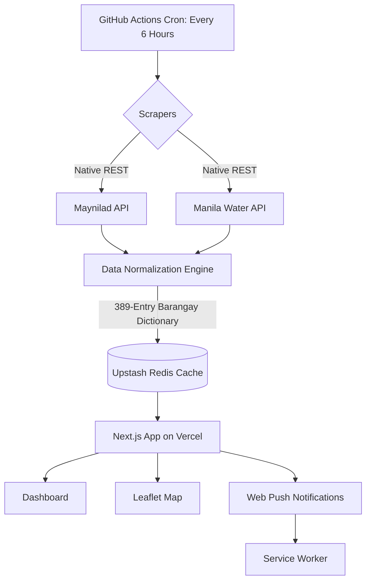

# TubigWatch 💧

**Live App:** [https://tubigwatch.vercel.app](https://tubigwatch.vercel.app) · **Interactive Map:** [https://tubigwatch.vercel.app/map](https://tubigwatch.vercel.app/map)

TubigWatch is a high-contrast, low-bandwidth Progressive Web App (PWA) that tracks water service interruptions for Metro Manila residents. It aggregates live advisories from both Maynilad and Manila Water into a single, unified dashboard.

## 🚀 The Problem

During typhoon season, water advisories are scattered across slow, mobile-hostile websites. Residents need to know instantly if their barangay is affected so they can store water. Furthermore, serverless platforms like Vercel have strict timeout limits, making it impossible to scrape 18+ pages of data on-demand.

## 🏗️ System Architecture

We bypass serverless timeouts by offloading heavy scraping to a scheduled GitHub Action, caching the final dataset in Upstash Redis.



## ✨ Key Features

- **Resilient Data Pipeline:** Scrapes both Maynilad and Manila Water without hitting Vercel's timeout limits by using GitHub Actions to write directly to Redis.
- **Data Normalization:** A 389-entry barangay dictionary that resolves messy data, splits multi-city strings, and cleans parsing artifacts (e.g., "Parts of Brgy. Rizal").
- **Real-time Push Notifications:** Users can opt-in to receive browser push alerts (via VAPID) when a new outage affects their pinned cities or barangays.
- **Personalized Favorites:** Users can "Pin" specific cities or barangays to highlight them and filter the dashboard.
- **Interactive Map:** Color-coded pins (Red for Active, Amber for Scheduled), auto-centering based on geolocation, and shareable URL filters.
- **Offline PWA:** Service workers cache the last known state so users can access advisories even if their internet drops during a storm.
- **Admin Override Panel:** A secure, rate-limited dashboard (`/admin`) to manually inject data into Redis if the upstream APIs break.
- **Security Hardened:** Timing-safe password comparisons, strict CSP headers, Zod validation on write endpoints, and Upstash Redis rate-limiting.

## 💻 Tech Stack

- **Framework:** Next.js 15 (App Router), React 19
- **Language:** TypeScript (Strict Mode)
- **Styling:** Tailwind CSS v4 (High-contrast, accessible civic UI)
- **Data & Scraping:** Node.js, `tsx`, custom HTML-table tokenizer
- **Validation:** Zod (Zero-trust runtime schema validation)
- **Database:** Upstash Redis (Caching & Subscriptions)
- **Push:** Web Push API (`web-push`), VAPID
- **Maps:** React-Leaflet, OpenStreetMap
- **Testing:** Vitest, Playwright, Custom AST/Regex Anti-slop Guardrail
- **CI/CD:** GitHub Actions, Vercel

## 🛠️ Local Development

```bash
# Install dependencies
npm install

# Set up environment variables
cp .env.example .env.local
# Add your UPSTASH_REDIS_REST_URL, UPSTASH_REDIS_REST_TOKEN, and VAPID keys to .env.local

# Run the development server
npm run dev
```

*(Note: To test the UI without hitting external APIs, visit `http://localhost:3000/?source=fixtures` to load demo data).*

## 🧪 Quality Gates

Every commit must pass 5 strict gates before merging:
1. `npm run typecheck` (Strict TypeScript)
2. `npm run lint` (ESLint + Custom Anti-slop Guardrail)
3. `npm run test` (Vitest Unit Tests + Guardrail Tests)
4. `npm run build` (Next.js Production Build)
5. `npm run e2e` (Playwright Browser Tests)
